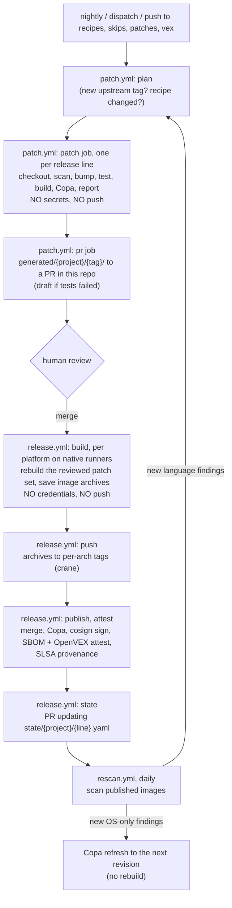

# Architecture

support-images rebuilds the upstream open-source images we run from source, with vulnerable
dependencies bumped. It verifies each rebuild with the upstream project's own tests and publishes
signed, patched images. This page explains how the pieces fit together. For field-level
configuration see [recipes.md](recipes.md); for day-to-day operation see [runbook.md](runbook.md).

## Why rebuild from source

Copacetic (Copa) patches OS packages inside an existing image. Most findings in these images are
elsewhere:
- in **language dependencies** (Go modules, Rust crates, Maven and Gradle jars, npm and Python packages),
- in the **Go standard library** compiled into binaries,
- in **third-party binaries the image bundles** (helm, kustomize, git-lfs, gomplate, credential helpers).

Only a rebuild fixes those. The pipeline does the rebuild, and keeps Copa for the OS packages that
remain. What can't be rebuilt gets what is possible:

| Image | What the pipeline does |
|---|---|
| Open source, buildable | Rebuild with bumped dependencies, upstream tests, then Copa |
| Bundles open-source binaries it doesn't build | Each binary is a **component**: rebuilt from its own source at the same version, tested, and swapped into the image |
| Unpacks a third-party Java distribution (Maven's `lib/`, Kafka's `libs/`) | Its vulnerable jars are swapped for the fixed releases from Maven Central (**bundled jars**), pinned by sha256, then smoke-tested |
| Closed source (`mode: image-only`) | Components for any open-source helpers it ships; Copa for OS packages, optionally Python and npm packages too (`copa: {libraries: true}`); VEX and vendor-release tracking for the rest |

## Components

| Component | Where | Role |
|---|---|---|
| Recipes | `recipes/<project>.yaml`, `recipes/_global.yaml` | What to patch, test and build for each upstream project, plus org-wide policy, overrides and holds |
| Skips / VEX / patches | `skips/`, `vex/`, `patches/<project>/` | Human decisions: tests to skip, findings accepted with a reason, hand-written patches and extra files |
| `patcher` CLI | `patcher/src/patcher/` | All of the logic (below). Every workflow job is a thin wrapper around one CLI command |
| Patcher image | `patcher/Dockerfile` | The CLI plus every tool it shells out to (trivy, copa, mise, cosign, osv-scanner, yq, crane, docker CLI, buildx, compose, compilers). All pinned |
| Generated patch sets | `generated/<project>/<tag>/` | Written by CI and reviewed through PRs: `deps.patch`, `bump-plan.json`, `report.md`, and `jars.json` when bundled jars are swapped |
| Release state | `state/<project>/<line>.yaml` (one file per line, so lines released together don't conflict) | What was published: tag, revision, platforms, digests, and the fixable findings known at release time |
| Workflows | `.github/workflows/` | `patch`, `release`, `rescan`, `patcher-image`, `tool-pins`, plus Dependabot (`.github/dependabot.yml`) |

### Inside the CLI

| Module | Responsibility |
|---|---|
| `models.py`, `config.py` | Recipe, skip, VEX and state models (these generate `schema/`); loading and merging `_global.yaml` |
| `upstream.py` | Resolving release lines (tags or branch heads) and shallow checkout. Applies patches, commits locally, re-tags, and produces the diff |
| `scan.py`, `planner.py`, `versions.py` | Trivy wrappers. The planner picks the smallest fixed version within policy, then applies overrides and holds. Version ordering for semver, Maven and Go |
| `ecosystems.py` | One row per ecosystem: Trivy types, lockfiles, toolchain needs, version-level rules. The other modules derive their per-ecosystem tables from it |
| `adapters/` | One adapter per ecosystem: `gomod`, `cargo`, `maven`, `gradle`, `node` (npm/pnpm/yarn), `python` (uv/poetry/pipenv/pip-tools/pinned), `dockerfile`, `files` |
| `toolchain.py`, `detect.py` | mise-installed toolchains for each recipe (or the upstream repo's own mise pins); versions the checkout declares fill unset fields |
| `tests_runner.py` | Runs the upstream tests, translates skips per framework, handles quarantine via JUnit, optionally runs as non-root, extracts comparable failing-test ids |
| `releases.py` | Publish times per registry, the release-age gate, the CISA KEV list, and the install cutoff for test environments |
| `reach.py` | govulncheck reachability (draft VEX) and the osv-scanner malicious-package check |
| `components.py` | Bundled binaries: find the version, patch and test it with its component recipe, overlay it into the image |
| `jars.py` | Bundled Java distributions: plan jar swaps like Maven bumps, fetch the jars from Maven Central pinned by sha256, overlay them (with the components) and re-apply them at release |
| `onboarding.py`, `inventory.py` | `patcher init` drafts; `inventory.yaml` coverage; upstream release lines no recipe tracks |
| `eol.py` | End-of-life runtimes (endoflife.date): the Dockerfile bases of each tracked line, after `minVersions`, and the recipes' toolchains |
| `build.py`, `copa.py`, `registry.py` | buildx or custom builds, smoke tests, Copa per platform, anonymous registry lookups |
| `archive.py` | Image archives, the release build's hand-off to the push job: `docker save`, the one-image-of-this-platform check, `crane push` |
| `report.py`, `vex.py` | Before/after report (the PR body), and OpenVEX documents for each image |
| `pipeline.py` | Stage orchestration for `run`, `release-plan`, `release-build`, `release-push`, `publish`, `rescan`, `refresh`, `plan` and `collect` |
| `pins.py` | Updates the tool pins (version + sha256) in `patcher/Dockerfile` |

## End-to-end flow

### Stages of `patcher run` (the patch job)

1. **Resolve** the release line to an upstream tag (or branch head) and commit.
2. **Scan the upstream image** to get the "before" picture.
3. **Check out** the source, apply `patches/<project>/*.patch`, copy `patches/<project>/files/`.
4. **Install toolchains** with mise, then run the recipe's `prepare` commands.
5. **Scan the source** with `trivy fs`, plan the bumps, apply them, and scan again (up to `maxRounds`).
   A fix is only planned when its release is at least `minReleaseAgeDays` old, unless the finding is
   CRITICAL or on CISA's KEV list.
6. **Refresh base images** and edit pinned versions in files. The Go builder images are raised to the
   Go version the plan requires.
7. **Regenerate** code if the recipe says so, then **commit locally**. The upstream tag is moved to
   that commit, so version stamping still reports the upstream version.
8. **Check the bumped versions** against OSV's malicious-package advisories (osv-scanner). A hit stops
   the run here, before any upstream code runs with the new packages.
9. **Run the upstream tests** with skips applied. Installs the test setup does from version ranges
   only see releases older than the release-age rule (`UV_EXCLUDE_NEWER`, `PIP_UPLOADED_PRIOR_TO`,
   npm `before`), or the upstream release time if that is later. If tests fail:
   - the same tests run on the unpatched source (the **baseline**). If every failure is also there,
     the run is `tests-preexisting`;
   - otherwise, if any bump was above patch level, the run retries once with patch-level bumps only.
10. **Build** each image for the native platform.
11. **Components and bundled jars:** the built image is scanned. Each bundled binary's version is
    found, and its component recipe is patched and tested at that version. Each fixable jar of a
    bundled Java distribution (`bundledJars`) is planned like a Maven bump and downloaded from Maven
    Central. One overlay build swaps both in. The binaries are cross-compiled per platform in buildx
    stages; each jar is copied over the old one, keeping its file name.
12. **Smoke** commands, then **Copa** for fixable OS packages (and libraries if enabled), then the
    "after" scan.
13. **Plan from the image** (`scan.image`, default for Gradle and Python): fixable findings in the
    image's own jars, Python packages or node_modules that the source scan couldn't see become bumps
    in the matching ecosystem. One more attempt runs; if its tests fail, the first pass is kept.
14. **Reachability** (Go): govulncheck drafts VEX suggestions for what remains.
15. **Write** `report.md`, `deps.patch`, `bump-plan.json`, `jars.json`, `summary.json`,
    `vex-suggestions.yaml`, OpenVEX, and each component's own outputs under `components/`.

`deps.patch` is the full diff from the upstream commit. It includes the hand-written patches and
files, so the release flow rebuilds exactly what was reviewed: it re-applies `deps.patch` to the
verified upstream commit and nothing else. Components work the same way: their reviewed
`components/<name>/deps.patch` is applied to their own verified commit and overlaid. So do bundled
jars: the release swaps exactly the jars in `jars.json`. Each download must match its recorded
sha256, and the image must still contain the exact jar it replaces.

### Why the baseline and the cutoffs

Upstream suites fail for reasons that have nothing to do with our bumps. Seen in this repo:
- tests that need the internet, a cloud account, or a binary we don't install;
- a test dependency that upstream doesn't pin, released days ago and incompatible. For example,
  pytest-asyncio 1.4.1 broke all 857 JupyterHub tests three days after JupyterHub 6.1.1 shipped.

The baseline separates "broken upstream" from "broken by us" without anyone reading logs. The install
cutoff keeps test environments close to what upstream's CI saw when it released. It also keeps a
freshly published, possibly malicious package out of the test run.

## Release flow

`release.yml` rebuilds a merged patch set and publishes it. Each stage is its own job, so upstream code never runs
in a job that holds registry credentials:

| Job | What it does | Upstream code | Permissions |
|---|---|---|---|
| `plan` | `patcher release-plan`: the line, whether anything is built, the platforms and their runners. A push that lands several patch sets dispatches one run per line instead | no | `contents: read`, `actions: write` |
| `build`, one per platform | `patcher release-build`: applies the reviewed `deps.patch` to the verified upstream commit, builds each image for the platform with its components and bundled jars overlaid, and saves it as an archive (`docker save` to `images/<arch>/<image>.tar`), uploaded as an artifact | **yes** | `contents: read` only. No login, no cache |
| `push` | `patcher release-push`: takes the next free revision, checks every archive, pushes each to `<final>-<arch>` with crane | no | `packages: write` |
| `publish` | `patcher publish`: merges the per-arch images, Copa, final and moving tags, scan, OpenVEX, release record; then cosign signs and attaches the SBOM and OpenVEX | no | `packages: write`, `id-token: write` |
| `attest` | SLSA build provenance, one per image (skipped for an image that has it already) | no | `packages: write`, `id-token: write`, `attestations: write` |
| `state` | the PR updating `state/<project>/<line>.yaml`, from `publish`'s job outputs | no | GitHub App token (`contents`, `pull-requests: write` for its fallback) |

**Why the build job gets no credentials.** Building upstream code runs it: the recipe's `build.setup` (upstream
Makefile targets), custom build `command`s, and every Dockerfile `RUN` step. That code has the Docker socket, so it
is root on the runner: it can read every file and every process's memory there, `~/.docker/config.json` and the
runner's own tokens included. Logging in only after the build, in the same job, doesn't help: something the build
started can wait for the credentials to show up. So the job that builds holds nothing worth taking (a read-only
`GITHUB_TOKEN`, and its run's artifact and cache tokens), and the only thing of it that is used later is the archives.

**The hand-off.** The archives come from an untrusted job, so they are data:
- `release-push` takes no name, tag or path from them. Every tag is computed from the recipe and the reviewed patch
  set: `<registry>/<image>:<final>-<arch>` for each image and each of its platforms. Only the archives at the expected
  paths are read; each must hold exactly one image, of that platform; all are checked before anything is pushed; and a
  tag that exists is never overwritten.
- What is inside the images is what the build produced, as before this split: the release rebuilds exactly the
  reviewed patch set.
- **One line per run.** A job can write any artifact of its own run (the runner holds the token), so in a run that
  released two projects, one project's build could replace the other's archives. A push that lands several patch sets
  therefore dispatches a run per line, and a run's archives only ever come from that line's own build. For the same
  reason no later job reads an artifact: `publish` hands the provenance subjects and the `state/` file to `attest` and
  `state` as job outputs, which no other job can write.
- **No cache where credentials are, or where a release is built.** Any job on a branch can write that branch's GitHub
  Actions cache, the jobs that run upstream code included. A job that reads it can end up running binaries another job
  planted: the patcher image's layers, toolchains on `PATH`. So every `release.yml` job that runs the patcher, and Copa
  refresh, builds the patcher image without the layer cache and restores no toolchain cache (`run-patcher` with
  `image-cache: "false"` and no `cache-key`), and the plan job's `setup-uv` restores no cache either. The release build
  takes longer for it, but one project's code can't reach another project's release. The patch jobs still share
  caches; what they produce is reviewed in the PR.

- **Image-only recipes** build nothing in `build`: `publish` overlays their components and bundled jars onto the
  vendor image in one cross build, for every platform at once. The components' build commands run in BuildKit build
  steps there, without the Docker socket or the job's credentials, but in the job that holds them. Moving them into
  the credential-free build is a follow-up ([roadmap](roadmap.md)); today the only image-only recipe isn't published.

**Platforms.** `build.platforms` (default `linux/amd64`, `linux/arm64`) are the platforms a line is released for, and
an image's own `platforms` narrows it to a subset. `release-plan` turns them into the build matrix, one native runner
per platform (`ubuntu-24.04`, `ubuntu-24.04-arm`; there is no native runner for others, so they are refused). Each
image is built, pushed and merged for exactly its platforms. The `PATCHER_PLATFORMS` variable narrows every recipe to
fewer platforms, e.g. arm64 only ([runbook](runbook.md#fewer-platforms)). A line that can't be released (an unknown recipe or
line, a platform without a runner) fails the run, after the other lines of the same push are dispatched.

**Recovery.** `state/` is written last, so it only records complete releases: signed, with SBOM, OpenVEX and
provenance. A run that fails after its builds leaves an unrecorded revision, and dispatching the release with
`rebuild: false` finishes it without building again (see [Tags and revisions](#tags-and-revisions) and the
[runbook](runbook.md#a-release-failed-after-the-builds)). Re-running failed jobs (`gh run rerun --failed`) uses the
workflow and action files of the commit that started the run, so it only helps with transient failures.

## Trust boundaries

| Job | Runs upstream code? | Credentials |
|---|---|---|
| `patch.yml` / patch | yes (builds and tests) | none: `contents: read`, no secrets, nothing pushed |
| `patch.yml` / pr | no | GitHub App token (to open PRs that trigger checks) |
| `release.yml` / build | yes (re-runs the reviewed build) | none: `contents: read`, no login, no cache; its images leave it as archives |
| `release.yml` / push | no | `packages: write`; pushes only the per-arch tags it computes |
| `release.yml` / publish, attest | no | `packages: write`, `id-token: write` (keyless cosign), `attestations: write` |
| `release.yml` / plan, state | no | `actions: write` (dispatch); GitHub App token (the `state/` PR) |
| `rescan.yml` | no | `packages: read`; refresh adds `packages: write` + `id-token: write`, and reads no cache |
| `tool-pins.yml` | no | GitHub App token |

Supply-chain rules for the pipeline itself:
- Every GitHub Action is pinned to a commit SHA.
- Every tool download in the patcher image is pinned to a version and its sha256.
- Jobs that hold write credentials, and the release build, read no GitHub Actions cache (see
  [Release flow](#release-flow)). `patcher/tests/test_workflows.py` checks these rules, and that no job that runs
  upstream code can write or logs in.
- New releases of anything the pipeline uses are only adopted once they are **14 days old**:
  Dependabot's `cooldown` and `patcher pins --min-age-days`. Trivy's release channels were
  compromised in March 2026 (GHSA-69fq-xp46-6x23); a waiting period gives such incidents time to surface.

The same idea protects the images we build: bumps must be **7 days old** (CRITICAL and KEV fixes
excepted), bumped versions are checked against malicious-package advisories, and test installs are
held to the same cutoff.

## Tags and revisions

| Tag | Meaning |
|---|---|
| `<upstream tag>-patched.<revision>` | Immutable release, e.g. `v2.46.1-patched.3`, `v2.46.1-distroless-patched.3` |
| `<upstream tag>-patched` | Moving tag that always points to the newest revision |
| `<final>-<arch>`, `<final>-build` | Staging tags used while releasing: the push job's per-arch images and their merge. When Copa patches several platforms it pushes its per-platform results under the same `<final>-<arch>` names. Safe to garbage-collect once the revision is in `state/` |

How revisions are chosen:
- **First release** of a new upstream tag is revision 1.
- **Release flow:**
  - `release-push` takes the first revision after the one `state/` records that has no tag in the registry yet, final
    or per-arch, for any image. Nothing is overwritten: not a revision whose `state/` PR isn't merged yet, and not the
    per-arch images a failed attempt left behind. A new build always takes a new revision, so revision numbers can skip.
  - `publish` merges the revision `release-push` pushed in the same run. If its final tag exists already, something
    else took the revision since (a Copa refresh of the line), and nothing is published: dispatch again. The exception
    is a re-run of the `publish` job (`--finish-existing`), which finishes what its first attempt pushed, as below.
  - With `rebuild: false`, nothing is built or pushed, and `publish` finishes the highest revision after the recorded
    one whose per-arch images all exist. An image whose final tag exists already (an earlier publish of that revision
    pushed it, then failed) is kept as it is: no second merge or Copa, so its digest stays. It is tagged, scanned and
    recorded again; signatures, SBOM, OpenVEX and provenance are only added where this workflow hasn't attached them
    yet. A revision `state/` records is never published again.
- **Copa refresh:** each refresh publishes a new revision of the same upstream tag, the first after the recorded one
  with no tag yet (as for a release). Copa pushes to a scratch tag, `<final>-refresh`; the result becomes `<final>` only
  if no release has taken that revision in the meantime, otherwise the refresh stops and the next rescan tries again.
- **Image-only releases:** each run publishes a new revision, the first after the recorded one with no final or
  `-build` tag yet.

## Rescan and `knownFixable`

At release time, each image's fixable findings are stored in `state/` as `knownFixable`. These are
already explained in the release PR (for example, CVEs inside a bundled helm binary). `rescan` acts
only on fixable findings that are **new** and not covered by a VEX statement:
- **new OS-package findings only:** `refresh`, a Copa re-patch that publishes the next revision;
- **any new language finding:** dispatch `patch.yml` for that line, so it is rebuilt from source.

## Keeping the pipeline itself current

| What | How | Schedule |
|---|---|---|
| GitHub Actions (workflows + composite action) | Dependabot `github-actions` | daily 07:00 America/New_York, 14-day cooldown |
| Patcher Python dependencies (`patcher/uv.lock`) | Dependabot `uv` | same |
| Patcher image bases (`python`, `uv` stages) | Dependabot `docker` | same |
| Tool downloads in `patcher/Dockerfile` (mise, trivy, copa, cosign, osv-scanner, yq) | `tool-pins.yml` → `patcher pins --write` | weekly, Monday 07:00 ET |

The upstream projects themselves are **not** handled by Dependabot. Their dependencies are bumped
by the patch flow above. Dependabot only acts on repositories you host, and the Dependabot CLI's job
format is undocumented. Each ecosystem's own tooling gives the pipeline control over minimum fixed
versions and policy caps.
