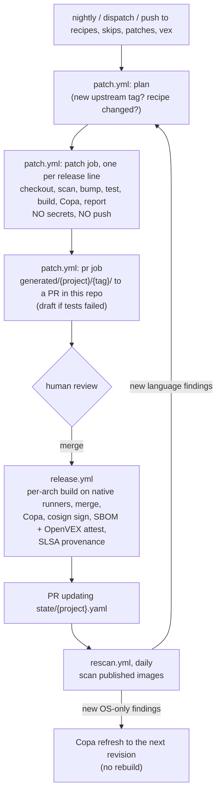

# Architecture

support-images rebuilds the upstream open-source images we run from source, with vulnerable
dependencies bumped. It verifies each rebuild with the upstream project's own tests and publishes
signed, patched images. This page explains how the pieces fit together. For field-level
configuration see [recipes.md](recipes.md); for day-to-day operation see [runbook.md](runbook.md).

## Why rebuild from source

Copacetic (Copa) patches OS packages inside an existing image. Most findings in these images are
elsewhere:
- in **language dependencies** (Go modules, Rust crates, Maven jars, npm packages),
- in the **Go standard library** compiled into binaries.

Only a rebuild fixes those. The pipeline does the rebuild, and keeps Copa for the OS packages that
remain.

## Components

| Component | Where | Role |
|---|---|---|
| Recipes | `recipes/<project>.yaml`, `recipes/_global.yaml` | What to patch, test and build for each upstream project, plus org-wide policy, overrides and holds |
| Skips / VEX / patches | `skips/`, `vex/`, `patches/<project>/` | Human decisions: tests to skip, findings accepted with a reason, hand-written patches and extra files |
| `patcher` CLI | `patcher/src/patcher/` | All of the logic (below). Every workflow job is a thin wrapper around one CLI command |
| Patcher image | `patcher/Dockerfile` | The CLI plus every tool it shells out to (trivy, copa, mise, cosign, yq, docker CLI, buildx, compose, compilers). All pinned |
| Generated patch sets | `generated/<project>/<tag>/` | Written by CI and reviewed through PRs: `deps.patch`, `bump-plan.json`, `report.md` |
| Release state | `state/<project>.yaml` | What was published: tag, revision, platforms, digests, and the fixable findings known at release time |
| Workflows | `.github/workflows/` | `patch`, `release`, `rescan`, `patcher-image`, `tool-pins`, plus Dependabot (`.github/dependabot.yml`) |

### Inside the CLI

| Module | Responsibility |
|---|---|
| `models.py`, `config.py` | Recipe, skip, VEX and state models (these generate `schema/`); loading and merging `_global.yaml` |
| `upstream.py` | Resolving release lines (tags or branch heads) and shallow checkout. Applies patches, commits locally, re-tags, and produces the diff |
| `scan.py`, `planner.py`, `versions.py` | Trivy wrappers. The planner picks the smallest fixed version within policy, then applies overrides and holds. Version ordering for semver, Maven and Go |
| `adapters/` | One adapter per ecosystem: `gomod`, `cargo`, `maven`, `node` (npm/pnpm/yarn), `dockerfile`, `files` |
| `toolchain.py` | mise-installed toolchains for each recipe (or the upstream repo's own mise pins) |
| `tests_runner.py` | Runs the upstream tests, translates skips per framework, handles quarantine via JUnit, optionally runs as non-root |
| `build.py`, `copa.py`, `registry.py` | buildx or custom builds, smoke tests, Copa per platform, anonymous registry lookups |
| `report.py`, `vex.py` | Before/after report (the PR body), and OpenVEX documents for each image |
| `pipeline.py` | Stage orchestration for `run`, `release-build`, `publish`, `rescan`, `refresh`, `plan` and `collect` |
| `pins.py` | Updates the tool pins (version + sha256) in `patcher/Dockerfile` |

## End-to-end flow

### Stages of `patcher run` (the patch job)

1. **Resolve** the release line to an upstream tag (or branch head) and commit.
2. **Scan the upstream image** to get the "before" picture.
3. **Check out** the source, apply `patches/<project>/*.patch`, copy `patches/<project>/files/`.
4. **Install toolchains** with mise, then run the recipe's `prepare` commands.
5. **Scan the source** with `trivy fs`, plan the bumps, apply them, and scan again (up to `maxRounds`).
6. **Refresh base images** and edit pinned versions in files. The Go builder images are raised to the
   Go version the plan requires.
7. **Regenerate** code if the recipe says so, then **commit locally**. The upstream tag is moved to
   that commit, so version stamping still reports the upstream version.
8. **Run the upstream tests** with skips applied. If they fail and any bump was above patch level,
   retry once with patch-level bumps only.
9. **Build** each image for the native platform and run the smoke commands.
10. **Copa** any fixable OS packages, then scan the result ("after").
11. **Write** `report.md`, `deps.patch`, `bump-plan.json`, `summary.json` and OpenVEX.

`deps.patch` is the full diff from the upstream commit. It includes the hand-written patches and
files, so the release flow rebuilds exactly what was reviewed: it re-applies `deps.patch` to the
verified upstream commit and nothing else.

## Trust boundaries

| Job | Runs upstream code? | Credentials |
|---|---|---|
| `patch.yml` / patch | yes (builds and tests) | none: `contents: read`, no secrets, nothing pushed |
| `patch.yml` / pr | no | GitHub App token (to open PRs that trigger checks) |
| `release.yml` / build | yes (re-runs the reviewed build) | `packages: write` (GHCR push) |
| `release.yml` / publish, attest | no | `packages: write`, `id-token: write` (keyless cosign), `attestations: write` |
| `rescan.yml` | no | `packages: read`; refresh adds `packages: write` + `id-token: write` |
| `tool-pins.yml` | no | GitHub App token |

Supply-chain rules for the pipeline itself:
- Every GitHub Action is pinned to a commit SHA.
- Every tool download in the patcher image is pinned to a version and its sha256.
- New releases of anything the pipeline uses are only adopted once they are **14 days old**:
  Dependabot's `cooldown` and `patcher pins --min-age-days`. Trivy's release channels were
  compromised in March 2026 (GHSA-69fq-xp46-6x23); a waiting period gives such incidents time to surface.

## Tags and revisions

| Tag | Meaning |
|---|---|
| `<upstream tag>-patched.<revision>` | Immutable release, e.g. `v2.46.1-patched.3`, `v2.46.1-distroless-patched.3` |
| `<upstream tag>-patched` | Moving tag that always points to the newest revision |
| `<final>-<arch>`, `<final>-build` | Staging tags used while releasing; safe to garbage-collect |

How revisions are chosen:
- **First release** of a new upstream tag is revision 1.
- **Release flow:**
  - `release-build` takes the next revision whose final tag doesn't exist in the registry yet. A
    `state/` PR that hasn't been merged can never cause a tag to be overwritten.
  - `publish` merges the highest revision whose per-arch builds all exist. A retried publish therefore
    finishes its own revision.
- **Copa refresh:** each refresh publishes the next revision of the same upstream tag.

## Rescan and `knownFixable`

At release time, each image's fixable findings are stored in `state/` as `knownFixable`. These are
already explained in the release PR (for example, CVEs inside a bundled helm binary). `rescan` acts
only on fixable findings that are **new** and not covered by a VEX statement:
- **new OS-package findings only:** `refresh`, a Copa re-patch that publishes the next revision;
- **any new language finding:** dispatch `patch.yml` for that line, so it is rebuilt from source.

## Keeping the pipeline itself current

| What | How | Schedule |
|---|---|---|
| GitHub Actions (workflows + composite action) | Dependabot `github-actions` | daily 07:00 America/New_York, 14-day cooldown |
| Patcher Python dependencies (`patcher/uv.lock`) | Dependabot `uv` | same |
| Patcher image bases (`python`, `uv` stages) | Dependabot `docker` | same |
| Tool downloads in `patcher/Dockerfile` (mise, trivy, copa, cosign, yq) | `tool-pins.yml` → `patcher pins --write` | weekly, Monday 07:00 ET |

The upstream projects themselves are **not** handled by Dependabot. Their dependencies are bumped
by the patch flow above. Dependabot only acts on repositories you host, and the Dependabot CLI's job
format is undocumented. Each ecosystem's own tooling gives the pipeline control over minimum fixed
versions and policy caps.
